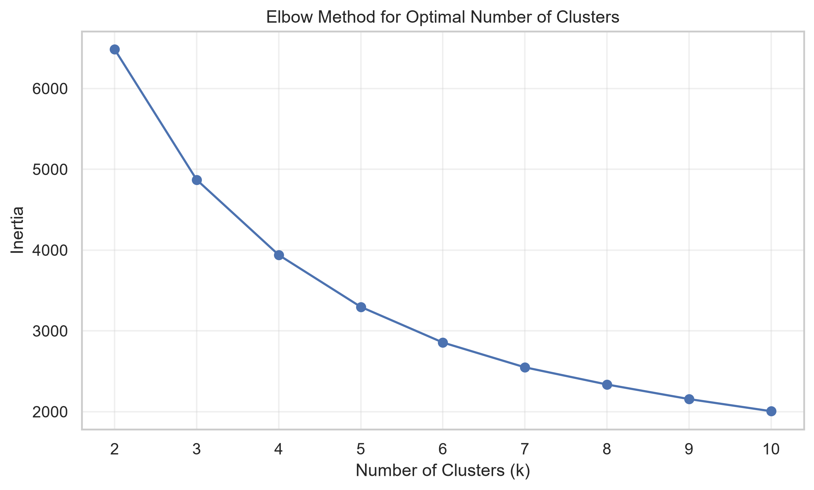
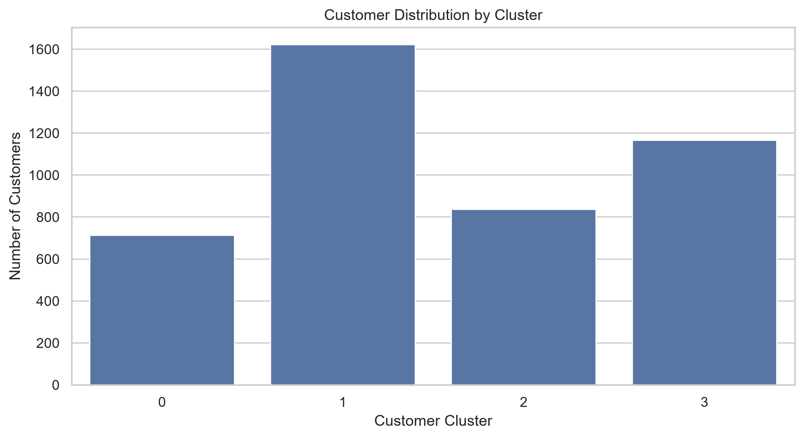
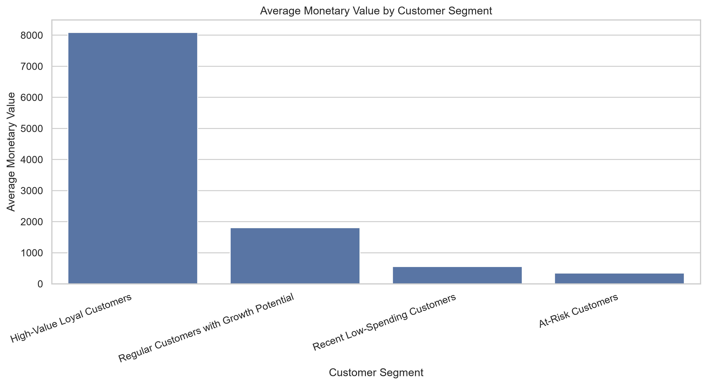
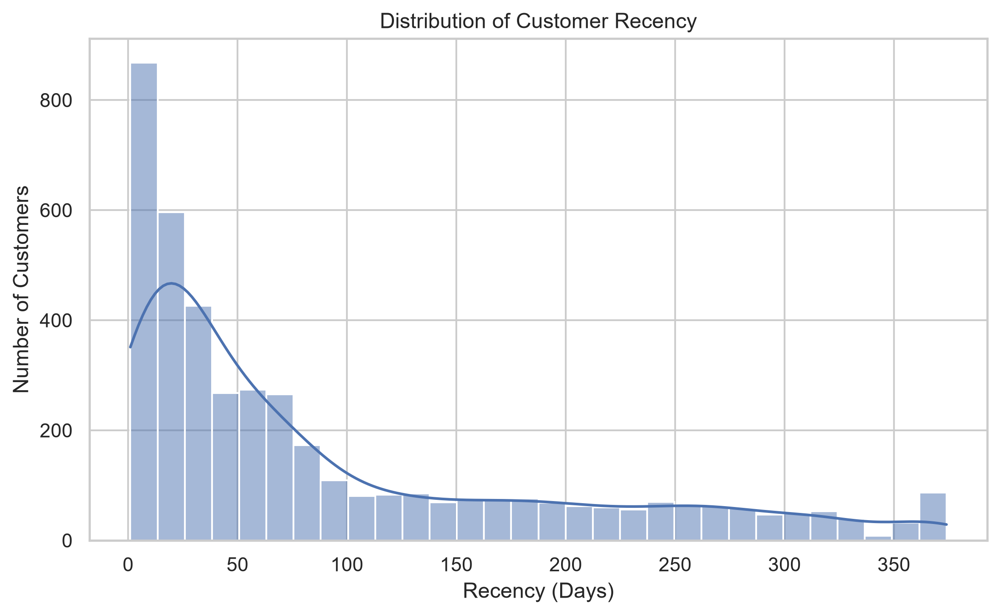
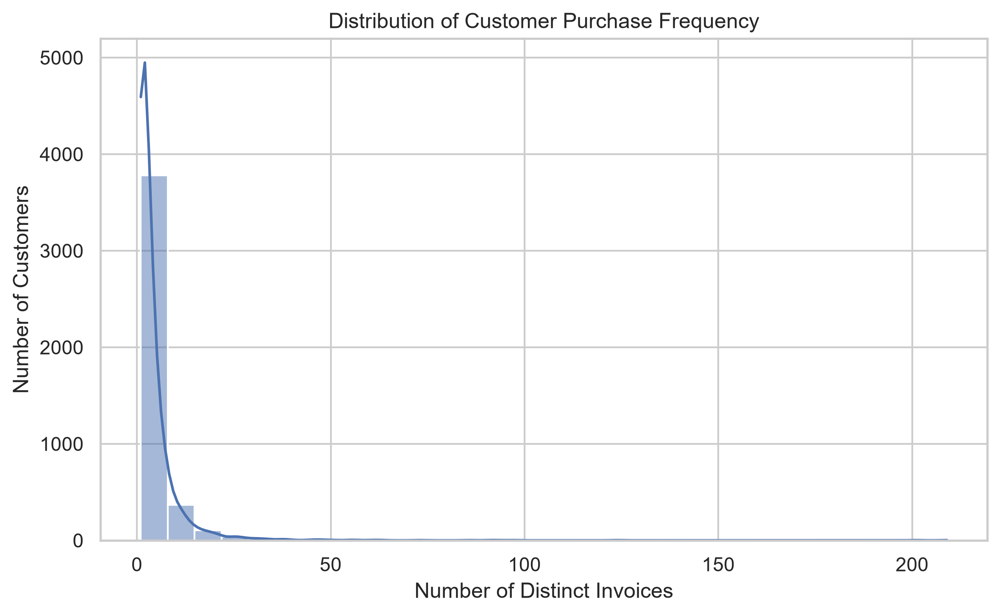
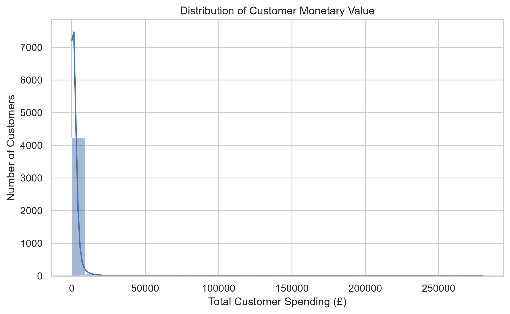
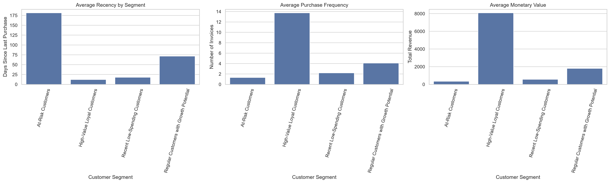

# 🛍️ Customer Segmentation Analysis Using Python

## 📌 Project Overview

Customer segmentation is an important data analytics technique that
helps businesses understand customer purchasing behavior and identify
groups with similar characteristics.

This project applies RFM (Recency, Frequency, Monetary) analysis and
K-Means clustering to segment customers based on their purchasing
behavior.

The objective is to identify high-value customers, customers at risk
of disengagement, recent low-spending customers, and regular customers
with growth potential.

The analysis provides actionable insights that can support targeted
marketing campaigns, customer retention, and loyalty strategies.

## 🎯 Business Problem

Businesses need to understand which customers contribute the most
value, which customers purchase frequently, and which customers may
need targeted engagement.

Analyzing all customers as one group can make it difficult to develop
effective marketing strategies.

This project uses RFM analysis and clustering to identify meaningful
customer segments and recommend appropriate business actions.

## 🎯 Project Objectives

- Analyze customer purchasing behavior using RFM metrics.
- Perform data cleaning and preprocessing.
- Standardize RFM features for clustering.
- Determine a suitable number of clusters using the Elbow Method.
- Apply K-Means clustering to group customers.
- Evaluate clustering performance using the Silhouette Score.
- Profile and interpret the resulting customer segments.
- Generate visualizations and export the final segmented dataset.
- Recommend business strategies for each customer segment.

## 🛠️ Tools and Technologies

- Python
- Pandas
- NumPy
- Matplotlib
- Seaborn
- Scikit-learn
- Jupyter Notebook
- Git and GitHub

## 📂 Project Structure

```text
Oasis_Customer_Segmentation/
│
├── notebook/
│   └── customer_segmentation.ipynb
│
├── data/
│   ├── retail_cleaned.csv
│   └── customer_segmentation_results.csv
│
├── images/
│   ├── elbow_method.png
│   ├── customer_cluster_distribution.png
│   ├── average_monetary_by_segment.png
│   └── rfm_comparison_by_segment.png
│
├── README.md
└── requirements.txt
```

## 📊 Methodology

### 1. Data Preparation

- Loaded and examined the customer transaction data.
- Cleaned and prepared the data for analysis.
- Aggregated purchasing information at the customer level.
- Calculated Recency, Frequency, and Monetary metrics.

### 2. RFM Analysis

RFM analysis evaluates customers using three metrics:

- **Recency:** Number of days since the customer's last purchase.
- **Frequency:** Number of purchases or transactions, according to
  the project's calculation method.
- **Monetary:** Total customer spending during the analyzed period.

These metrics help describe customer engagement and purchasing value.

### 3. Feature Scaling

StandardScaler was used to standardize the log-transformed RFM features
so that differences in scale would not dominate the clustering process.

### 4. Optimal Number of Clusters

The Elbow Method was used to compare clustering inertia for different
values of K.

Four clusters were selected as a reasonable starting point based on
the observed elbow pattern.

### 5. K-Means Clustering

K-Means was applied to the standardized RFM features to group customers
with similar purchasing behavior.

### 6. Model Evaluation

The Silhouette Score was calculated to assess how well customers were
separated into clusters.

### 7. Customer Profiling

The average RFM metrics and customer counts were analyzed to interpret
the clusters and assign descriptive business labels.

### 8. Export

The final customer segmentation dataset was exported to CSV for further
analysis and reporting.

## 📈 Key Results

The final dataset contains **4,338 customers** and six columns:

- CustomerID
- Recency
- Frequency
- Monetary
- Cluster
- Segment

The analysis identified four customer segments.

| Customer Segment | Customers | Percentage | Average Monetary Value |
|---|---:|---:|---:|
| High-Value Loyal Customers | 713 | 16.44% | 8,088.02 |
| At-Risk Customers | 1,622 | 37.39% | 341.00 |
| Recent Low-Spending Customers | 837 | 19.29% | 557.32 |
| Regular Customers with Growth Potential | 1,166 | 26.88% | 1,801.78 |

*Monetary values are expressed in the units used in the source dataset.*

## 📉 Visualizations

### 1. Elbow Method

The Elbow Method helps assess a suitable number of clusters.



### 2. Customer Cluster Distribution

This chart compares the number of customers assigned to each cluster.



### 3. Average Monetary Value by Segment

This chart compares customer spending across the four business segments.



### 4. Recency Distribution

This histogram shows how recently customers made their last purchase.



### 5. Frequency Distribution

This histogram shows the distribution of customer purchase frequency.



### 6. Monetary Distribution

This histogram shows the distribution of total customer spending.



### 4. RFM Comparison Across Customer Segments

These charts compare average Recency, Frequency, and Monetary values.



## 💡 Key Business Insights

### High-Value Loyal Customers

These customers have the highest average purchase frequency and
monetary value, with recent purchasing activity.

**Recommendations:**
- Offer loyalty rewards and exclusive benefits.
- Provide personalized product recommendations.
- Encourage referrals and repeat purchases.

### At-Risk Customers

This is the largest segment, with relatively high average recency and
low purchase frequency and monetary value.

**Recommendations:**
- Run targeted re-engagement campaigns.
- Send personalized offers based on previous purchases.
- Monitor customer reactivation and repeat purchases.

### Recent Low-Spending Customers

These customers have purchased relatively recently but have lower
average purchase frequency and monetary value.

**Recommendations:**
- Encourage repeat purchases.
- Recommend complementary products.
- Test introductory offers and product bundles.

### Regular Customers with Growth Potential

These customers demonstrate moderate purchasing activity and
contribute meaningful monetary value.

**Recommendations:**
- Introduce tiered loyalty programs.
- Encourage more frequent purchases.
- Recommend complementary or higher-value products.

## 📌 Business Conclusion

RFM analysis combined with K-Means clustering provides a structured
approach to understanding customer purchasing behavior.

The results can help businesses prioritize customer retention,
personalize marketing campaigns, and identify opportunities to improve
repeat purchases and customer value.

Future work could include developing an interactive dashboard,
tracking customer behavior over time, and measuring the effectiveness
of targeted marketing campaigns.

## 🚀 How to Run the Project

### 1. Clone the Repository

```bash
git clone <YOUR_GITHUB_REPOSITORY_URL>
```

### 2. Navigate to the Project Folder

```bash
cd Oasis_Customer_Segmentation
```

### 3. Install Dependencies

```bash
pip install -r requirements.txt
```

### 4. Run the Notebook

Open `notebook/customer_segmentation.ipynb` in Jupyter Notebook or
Visual Studio Code and execute the cells.

Make sure the input dataset path in the notebook matches your local
folder structure.

## 👩‍💻 Author

**Mamta Chaudhary**

BSc Data Science & Artificial Intelligence

Interested in **Data Analytics, Business Intelligence, Machine Learning, and Data Science**.

### Connect with me

📧 **Email:** choudharymamta1003@gmail.com

💼 **LinkedIn:** https://www.linkedin.com/in/mamta-chaudhary-964128353/

---

⭐ If you find this project useful, consider giving the repository a star!
